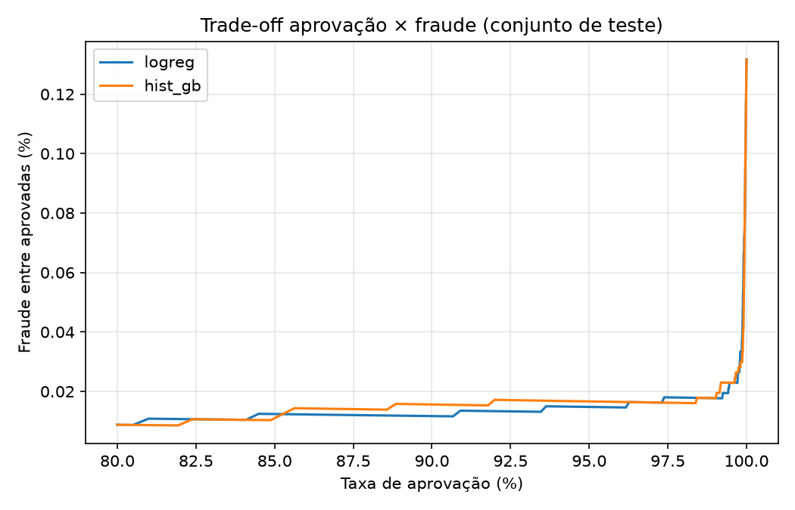

# Payment Decision Lab

Estudo de caso: **decidir se uma transação de e-commerce deve ser aprovada, enviada para revisão ou recusada**, otimizando *custo de negócio* e não só métrica de classificação.

> Dados públicos e anonimizados (ULB / Kaggle "Credit Card Fraud Detection"). Os custos são **hipóteses**, declaradas em `src/pdl/costs.py`. Não é um produto de nenhuma empresa.

## Por que este projeto
Em pagamentos, errar para um lado custa chargeback; errar para o outro custa uma venda legítima perdida. Os dois erros não valem o mesmo, e o valor da venda muda a conta. Acurácia ou AUC sozinhas não respondem "qual decisão tomar".

## Como rodar
```bash
pip install -r requirements.txt
# baixe creditcard.csv (Kaggle: mlg-ulb/creditcardfraud) e coloque em data/
python -m src.pdl.train          # treina, calibra, avalia -> reports/ e models/
python -m src.pdl.sensitivity    # análise de sensibilidade aos custos
pytest                           # testes
uvicorn src.pdl.api:app          # POST /decision
```

## Metodologia (resumo)
- **Split temporal** 60/20/20 (treino < validação < teste). Split aleatório vazaria o futuro. `Time` não é feature.
- **Calibração (Platt)** na validação, porque a decisão usa probabilidade, não ranking.
- **Política A:** limiar global na probabilidade, escolhido na validação (binária: aprovar/recusar).
- **Política B:** para cada transação, escolhe a ação de menor custo esperado entre aprovar, revisar e recusar:
  - aprovar: `p · (valor + taxa_chargeback)`
  - recusar: `(1 − p) · margem · valor`
  - revisar: `taxa_revisão`
- Modelo escolhido por PR-AUC na **validação**. O teste é usado só para a avaliação final.
- Incerteza: IC95% por bootstrap sobre as transações do teste.

## Resultados (teste, 56.962 transações, 75 fraudes)
Hipóteses: chargeback R$15 fixo, margem 20%, revisão R$5.

| Política (HistGB) | Custo | Economia vs. aprovar tudo | IC95% |
|---|---|---|---|
| Aprovar tudo | 8.854 | — | — |
| A: limiar global | 9.611 | −757 | [−13.724; 7.938] |
| B: custo esperado, 3 ações | 2.941 | **+5.913** | [2.603; 10.456] |

B: 99,24% aprovadas, 0,11% em revisão, 0,65% recusadas; 55 fraudes recusadas, 5 revisadas, 15 aprovadas. Recusa 314 transações legítimas, mas de valor baixo (recusar custa só a margem).
Sensibilidade (`sensitivity.py`): a economia permanece positiva nas 27 combinações de margem, chargeback e taxa de revisão testadas. Com Logreg, B **não** tem IC que exclua zero.



## O que eu aprendi / decisões 
- Por que a política A perdeu para "aprovar tudo"? (dica: olhe a maior transação legítima do teste e quanto custa recusá-la)
- Por que a calibração importa para a política B e não importaria só para ranquear?
- Por que o IC do Logreg cruza zero e o do HistGB não? O que isso diz sobre confiar em um único número?
- O que mudaria com dados reais? (ver limitações)

## Limitações
- Dataset de 2 dias, features anonimizadas por PCA: não dá para explicar *por que* uma transação foi marcada.
- Apenas 75 fraudes no teste: resultado ruidoso; o IC existe por isso.
- Custos são hipóteses; revisão manual assumida perfeita e com capacidade ilimitada.
- Sem drift em produção, sem fraude adaptativa, sem atraso de label (chargebacks chegam semanas depois).
- Calibração de Platt com poucos positivos na validação (57).
